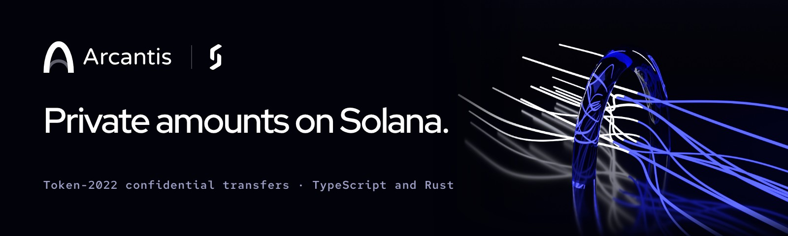

<p align="center"></p>

# Arcantis

TypeScript SDK for **Token-2022 Confidential Transfers** on Solana, built on
[`@solana/kit`](https://github.com/anza-xyz/kit). It packages ElGamal/AES key handling,
zero-knowledge proof generation, proof-context accounts and the confidential-transfer
instructions into a handful of async functions, so you can add encrypted balances and private
transfers without hand-assembling the primitives.

A Rust crate with the core helpers lives in [`rust/`](#rust).

> **Status: 1.0.0-rc.2**, the release candidate for an independent audit. Arcantis continues
> `@softseco/confidential-transfers` 3.3.0 (TypeScript) and `softseco-confidential-transfers`
> 3.0.0 (Rust) under a new name; the functions keep their names. Built on `@solana/kit` 8. The whole flow (configure, deposit, apply,
> transfer, withdraw) runs end-to-end on **devnet** and against a local validator, in Node and in
> the browser. The SDK is self-audited, not independently audited. It runs on **Node ≥ 20.18**
> and in web apps: bundlers pick the browser build by themselves, keys come from the user's
> wallet, and a wallet is asked once per operation ([web apps guide](./guides/web-apps.md)).
> Confidential transfers depend on Solana's ZK ElGamal Proof Program: it is enabled on devnet, and
> `npm run example:mainnet` checks mainnet for you (see [On mainnet](#on-mainnet)).
> Upgrading from 2.x means moving your app to `@solana/kit` 8; see [CHANGELOG.md](./CHANGELOG.md).
>
> **API reference:** [softseco.github.io/arcantis/api](https://softseco.github.io/arcantis/api/)

## Try it in your browser

**[softseco.github.io/arcantis](https://softseco.github.io/arcantis/)** runs a confidential token
on devnet in a browser tab, with throwaway keys: a mint with an auditor key and
[Vigilantis](https://github.com/softseco/vigilantis) as its transfer hook, a confidential payment,
who can decrypt it, a withdraw, then a blocked wallet, a frozen account and a paused token, and
finally the auditor's report as CSV or JSON. Nothing to install. The source is in
[`playground/`](./playground).

## Try it on devnet

```bash
git clone https://github.com/softseco/arcantis
cd arcantis
npm install
solana airdrop 1 --url devnet     # or https://faucet.solana.com, the example needs ~0.8 SOL
npm run example:devnet
```

[`examples/devnet.ts`](./examples/devnet.ts) pays from your Solana CLI wallet
(`~/.config/solana/id.json`, or set `SOLANA_KEYPAIR`). It creates a confidential mint and two
wallets, then configures both accounts, deposits, applies, transfers confidentially, withdraws
part of the balance back to public and decrypts the results. Every transaction is printed with an
explorer link. The public devnet RPC rate-limits; set `DEVNET_RPC` and `DEVNET_WS` to your own
endpoint if it gets slow.

## On mainnet

```bash
MAINNET_RPC=https://your-mainnet-endpoint npm run example:mainnet            # checks only
MAINNET_RPC=https://your-mainnet-endpoint npm run example:mainnet -- --send  # runs it
```

[`examples/mainnet.ts`](./examples/mainnet.ts) first checks, in a free simulation, that
mainnet's ZK ElGamal Proof Program accepts the proofs this SDK makes, and what the run would cost.
With `--send` it runs the whole flow with a test token and tiny amounts (1.00 in, 0.25 sent
confidentially, 0.10 withdrawn), with a priority fee, paid from your Solana CLI wallet. It costs
about 0.01 SOL, almost all of it rent that stays with the test mint and the two token accounts.

## Features

- **`configureAccount`** enables a Token-2022 account for confidential transfers (with the PubkeyValidity ZK proof)
- **`deposit`** moves tokens from the public balance into the confidential **pending** balance
- **`applyPendingBalance`** rolls the pending balance into the **available** balance, checked so that a payment arriving at the same moment cannot leave the account's balance copies apart; `transfer` and `withdraw` do this by themselves
- **`decryptBalance`** decrypts your own available balance locally (read-only), with what is pending if you ask (`includePending`)
- **`transfer`** sends an encrypted amount to another account in one transaction, its three proofs (equality, ciphertext-validity, range) inside
- **`withdraw`** moves tokens from the confidential balance back to the public balance, also in one transaction (equality and range proofs)
- **`closeAccount`** closes an emptied account and returns its rent deposit
- **Transfer-hook mints**: `transfer` resolves the mint's transfer-hook accounts, so confidential transfers work on mints that enforce rules through a hook
- **Auditor selective disclosure**: derive an auditor ElGamal identity and recover transfer amounts on an auditor-enabled mint, without the power to spend
- **Built for real use**: a transfer is one v1 transaction (up to 4,096 bytes, accepted by Solana since September 2026), so it confirms like any other payment; the fee payer can be a relayer, so the sender needs no SOL. For a wallet that cannot sign v1 transactions, `singleTransaction: false` sends the proofs through proof accounts instead: five transactions signed together (a wallet asks once), closed again if a step fails, and `recoverProofAccounts` cleans up after a process that stopped. Priority fees, retries on expiry, and typed errors (`ConfidentialTransfersError` with a `code`) for every case the SDK checks

Keys are derived deterministically from the account owner's wallet signer using the standard
confidential-balances derivation: one signature over the constant message `solana-conf-bal/v1`,
expanded through HKDF-SHA512 into the ElGamal and AES keys. They are bound to the wallet alone
(one keypair across every mint and token account), so they are recoverable from the wallet, never
need to be stored, and match what the Rust `solana-zk-sdk` and the Token-2022 clients derive for
the same wallet.

## Install

```bash
npm install @softseco/arcantis @solana/kit
```

`@solana/kit` (v8) is a peer dependency, so your app and the SDK share one copy and the types line
up.

## Usage

```ts
import {
  configureAccount,
  deposit,
  applyPendingBalance,
  decryptBalance,
  transfer,
  withdraw,
} from "@softseco/arcantis";

// 1. enable Alice's account for confidential transfers
const { token } = await configureAccount({ rpc, rpcSubscriptions, payer, owner: alice, mint });

// 2. move 1000 public tokens into Alice's confidential pending balance
await deposit({ rpc, rpcSubscriptions, payer, owner: alice, mint, amount: 1000n, decimals });

// 3. read your own balance (decrypted locally; nothing is revealed on-chain)
const balance = await decryptBalance({ rpc, owner: alice, mint, includePending: true }); // 1000n

// 4. privately transfer 600 to Bob: what is pending is applied in the same transaction
await transfer({
  rpc,
  rpcSubscriptions,
  payer,
  owner: alice,
  mint,
  destinationOwner: bob.address,
  amount: 600n,
});

// 5. move 400 of Alice's confidential balance back to her public balance
await withdraw({ rpc, rpcSubscriptions, payer, owner: alice, mint, amount: 400n, decimals });
```

Incoming amounts land in the pending balance. A one-transaction `transfer` or `withdraw` applies
them first, in the same transaction, so there is no separate step after receiving funds; if
another payment lands while that transaction is on its way, Token-2022 refuses it as a whole and
the call builds it again. With proof accounts (`singleTransaction: false`) only the available
balance can be spent, and `applyPendingBalance` comes first. A withdrawn amount is public (it is an
instruction argument); the balance that remains stays encrypted.

To send only to the key you expect, pass the recipient's ElGamal key from your own records as
`destinationElgamalPubkey`: the transfer is refused (`RECIPIENT_KEY_MISMATCH`) before anything is
encrypted if the RPC reports another one.

Runnable round trips: [`examples/devnet.ts`](./examples/devnet.ts) (`npm run example:devnet`) and
[`examples/confidential-transfer.ts`](./examples/confidential-transfer.ts) (`npm run example`,
against a local validator, see [Local development](#local-development)).

### Who signs and who pays

Every call takes two signers: `owner`, who holds the tokens and signs for them, and `payer`, who
pays Solana's network fee (and the rent of a new account) in SOL. They can be the same wallet,
which then signs once. With a separate `payer`, such as a relayer you run, the transaction carries
both signatures and the owner needs no SOL. `payer` can be any `@solana/kit` signer, including one
that asks your relayer for its signature. Arcantis adds no fee of its own.

Need a different setup, for example fees sponsored against a prepaid balance or a fee paid in the
token itself? Ask at [hello@softseco.com](mailto:hello@softseco.com).

### In a web app

Bundlers (Vite, webpack 5 and others that honour the `browser` export condition) use the browser
build with no configuration beyond one Vite dev-server line. Keys come from the user's wallet:
ask it to sign once, then pass the keys to every call so it is not asked again.

```ts
import { isMessageSigner } from "@solana/kit";
import { createSignerFromWalletAccount } from "@solana/wallet-account-signer";
import { deriveConfidentialKeys, transfer } from "@softseco/arcantis";

const signer = createSignerFromWalletAccount(walletAccount, "solana:devnet");
if (!isMessageSigner(signer)) throw new Error("This wallet cannot sign messages");
const keys = await deriveConfidentialKeys({ signer }); // one "sign message" prompt

await transfer({ rpc, rpcSubscriptions, payer: signer, owner: signer, mint, destinationOwner, amount, keys });
```

The [web apps guide](./guides/web-apps.md) covers loading the WebAssembly, wallet requirements
and what the user approves. [`examples/vite`](./examples/vite) is a complete app (connect, unlock,
deposit, apply, send, withdraw), and CI runs it in Chromium with a test wallet on every push.

### Transfer hooks

Token-2022 calls a mint's transfer hook on confidential transfers too, with the amount set to
`u64::MAX` because the real amount is encrypted. `transfer` reads the mint's
`ExtraAccountMetaList` and appends the accounts the hook needs, so no extra code is required.
`resolveTransferHookAccounts`, `getTransferHookProgram` and `findExtraAccountMetaListPda` are
exported for callers that build their own instructions.

### Auditor selective disclosure

A mint can designate an **auditor** ElGamal public key. Once set, every confidential transfer on
that mint also encrypts the amount to the auditor, who can recover it without being able to spend
and without weakening anyone else's confidentiality.

```ts
import {
  deriveAuditorElgamalKeypair,
  getAuditorElgamalPubkey,
  decryptTransferAmountAsAuditor,
  transfer,
} from "@softseco/arcantis";

// The auditor derives its ElGamal identity from its own wallet (nothing stored):
const auditorKeypair = await deriveAuditorElgamalKeypair(auditorWallet);

// Its public key goes into the mint's confidential-transfer config at mint creation:
const auditorElgamalPubkey = getAuditorElgamalPubkey(auditorKeypair);

// Senders route transfers to the auditor by passing that pubkey:
await transfer({ rpc, rpcSubscriptions, payer, owner: alice, mint, destinationOwner: bob.address, amount: 1000n, auditorElgamalPubkey });

// Given a confirmed transfer's signature, the auditor recovers the amount:
const amount = await decryptTransferAmountAsAuditor({ rpc, signature, auditorKeypair }); // 1000n
```

Since 3.3.0 `transfer` reads the mint's auditor key itself, so `auditorElgamalPubkey` is only
needed to override it.

For the whole mint at once, `listConfidentialActivity` lists every deposit, confidential transfer
and withdraw with the amounts decrypted, and `confidentialActivityToCsv` turns that into a
spreadsheet. Auditors who do not write code can run the same from the command line:

```bash
npx @softseco/arcantis audit-report --mint <mint> --keypair auditor-wallet.json \
  --rpc https://your-endpoint --out report.csv
```

See the [guide for auditors](./guides/auditors.md).

## API

| Function | Purpose | Notable inputs / output |
|---|---|---|
| `configureAccount` | Configure a Token-2022 account for CT | `rpc`, `rpcSubscriptions`, `payer`, `owner`, `mint` → `{ token, signature }` |
| `deposit` | Public balance → confidential pending | `…`, `amount`, `decimals` → `{ token, signature }` |
| `applyPendingBalance` | Pending → available, checked by a withdraw of zero in the same transaction | `rpc`, `rpcSubscriptions`, `payer`, `owner`, `mint`, optional `verify` → `{ token, signature }` |
| `decryptBalance` | Decrypt your available balance (read-only) | `rpc`, `owner`, `mint`, optional `includePending` → `bigint` |
| `transfer` | Private transfer between accounts, spending what is pending too | `…`, `owner`, `mint`, `destinationOwner` (or `destinationToken`), `amount`, optional `auditorElgamalPubkey`, `destinationElgamalPubkey`, `applyPending` → `{ sourceToken, destinationToken, signatures }` |
| `withdraw` | Confidential → public balance, spending what is pending too | `…`, `owner`, `mint`, `amount`, `decimals`, optional `applyPending` → `{ token, signatures }` |
| `closeAccount` | Close an emptied account, rent back | `…`, `owner`, `mint`, optional `destination` → `{ token, signature }` |
| `deriveAuditorElgamalKeypair` | Derive the auditor's ElGamal keypair from its wallet | `signer` → `ElGamalKeypair` |
| `getAuditorElgamalPubkey` | Auditor pubkey for a mint's CT config | `auditorKeypair` → `Address` |
| `decryptTransferAmountAsAuditor` | Recover a transfer's amount as the auditor | `rpc`, `signature`, `auditorKeypair`, optional `mint` → `bigint` |
| `resolveTransferHookAccounts` | Accounts a mint's transfer hook needs | `rpc`, `mint`, `sourceToken`, `destinationToken`, `owner` → `ResolvedAccount[]` |
| `deriveConfidentialKeys` | The wallet's standard ElGamal + AES keys, from one signature | `signer` → `{ elgamalKeypair, aesKey }` |
| `deriveConfidentialKeysWithSeed` | Seed-scoped, non-standard derivation | `signer`, `publicSeed` → `{ elgamalKeypair, aesKey }` |
| `pdaWalletPublicSeed` | Canonical seed for single-signer PDA wallets | `programId`, `walletPda`, `mint`, `tokenAccount` → `Uint8Array` |
| `initConfidentialTransfers` | Start loading the WebAssembly early (browser; no-op in Node) | optional `wasmUrl` |
| `recoverProofAccounts` | Close proof accounts a stopped transfer or withdraw left behind, and get the rent back | `rpc`, `rpcSubscriptions`, `authority` (the payer) → `{ closed, leftOpen, lamports }` |
| `listConfidentialActivity` | A mint's deposits, confidential transfers and withdraws, amounts decrypted with the auditor key | `rpc`, `mint`, `auditorKeypair`, optional `since`, `until` → `ConfidentialActivity[]` |
| `confidentialActivityToCsv` | That list as CSV | `activity`, optional `decimals` → `string` |
| `confidentialActivityToJson`, `parseConfidentialActivityJson` | That list as a JSON report that names its format and version, and back | `activity`, `mint`, optional `auditorElgamalPubkey`, `decimals` → `string`; `string` → `ConfidentialActivityReport` |
| `isConfidentialTransfersError` | Check an error's `code` (`INSUFFICIENT_FUNDS`, `PENDING_BALANCE_LIMIT`, `TRANSACTION_EXPIRED`, …) | `error`, optional `code` → `boolean` |

Every function accepts an optional `programAddress` (defaults to Token-2022). Functions that need
the owner's ElGamal/AES keys derive them from the `owner` signer, so no key storage is required,
or take them as `keys` (from `deriveConfidentialKeys`) to skip the signature. Functions that send
transactions also take `computeUnitPrice` (priority fee, micro-lamports per compute unit) and
`retries` (run again when a transaction expires; default 0); `transfer` and `withdraw` also take
`singleTransaction` (default `true`; `false` for a wallet or RPC without v1 transactions). Full reference:
[softseco.github.io/arcantis/api](https://softseco.github.io/arcantis/api/).

> **Upgrading from 2.x.** Move your app to `@solana/kit` 8. Function signatures and key
> derivation are unchanged, so accounts configured with 2.x keep working.
>
> **Upgrading from 1.x.** Key derivation changed in 2.0 to the ecosystem standard, so 1.x keys and
> later keys differ. Move the balance of a 1.x account out with a 1.x `transfer` to an account
> configured with the current version.

## Rust

The same operations, with the same keys, checks and error codes, are published as a Rust crate,
[`arcantis`](https://crates.io/crates/arcantis):

```bash
cargo add arcantis
```

```rust
let client = ConfidentialClient::new(rpc, Arc::new(payer));
client.configure_account(&alice, &mint).await?;
client.deposit(&alice, &mint, 1_000).await?;
client.transfer(&alice, &mint, &bob, 400).await?; // applies what is pending first
client.withdraw(&alice, &mint, 100).await?;
```

It handles transfer hooks, the mint's auditor key and failures partway like the TypeScript
package, and also supports token accounts owned by a program:
[`rust/examples/anchor-vault`](./rust/examples/anchor-vault) is an Anchor program that holds a
confidential balance and pays out of it. The two SDKs are checked against
[shared test vectors](./test-vectors). See [`rust/README.md`](./rust/README.md).

## Local development

Confidential-transfer instructions require an on-chain Token-2022 program that **matches the
client**, plus the ZK ElGamal Proof Program. The on-chain tests and the local example therefore
run against a local validator from **Agave 4.x**, with the Token-2022 build in
[`test/fixtures`](./test/fixtures):

```bash
# 1. start the validator with that Token-2022 loaded (leave running)
TOKEN_2022_SO=test/fixtures/spl_token_2022.so npm run validator

# 2. in another terminal, run the on-chain integration tests
CT_LOCAL_PROGRAM=1 npm test
```

Without `CT_LOCAL_PROGRAM=1` the on-chain tests are skipped and only the validator-free unit
tests run. CI runs both, plus the browser test. See [CONTRIBUTING.md](./CONTRIBUTING.md) for the
full workflow.

## Project status

`1.0.0-rc.2`, continuing `@softseco/confidential-transfers` 3.3.0 and the Rust crate
3.0.0. The TypeScript package covers the full confidential-transfer lifecycle (configure, deposit,
apply, transfer, withdraw, decrypt), transfer-hook mints and auditor selective disclosure, runs
end-to-end on devnet, works in web apps with browser wallets, handles failures halfway through a
transfer, and gives a mint's auditor a full report. Keys follow the ecosystem-standard
`solana-conf-bal/v1` derivation, pinned by test vectors that TypeScript and Rust share. Every
format Arcantis reads or writes is named and versioned, and one it does not know is refused rather
than misread ([docs/formats.md](./docs/formats.md)). The Rust crate has the same operations and
also serves programs that hold confidential balances. Changes are tracked in
[CHANGELOG.md](./CHANGELOG.md).

Planned next:

- An independent audit. What it covers, how to build and test, and the test coverage are in
  [docs/audit-scope.md](./docs/audit-scope.md); the threat model, with the findings of our own
  review, is [docs/threat-model.md](./docs/threat-model.md).

## Security

Confidential transfers are cryptographic and security-sensitive. To report a vulnerability, see
[SECURITY.md](./SECURITY.md). Please do not open a public issue for security reports.

## License

Business Source License 1.1; see [LICENSE](./LICENSE). Testing and development are free for
everyone. Production use is free with eUSD for everyone, and with other tokens for companies
whose Total Finances are up to USD 5,000,000, provided you tell us at developers@softseco.com;
above that it needs a commercial license. [COMMERCIAL-LICENSE.md](./COMMERCIAL-LICENSE.md) says
it in plain words. Each version becomes Apache-2.0 four years after its release. Versions
published as `@softseco/confidential-transfers` (up to 3.3.0) and `softseco-confidential-transfers`
(up to 3.0.0) remain available under Apache-2.0 at github.com/softseco/confidential-sdk.
