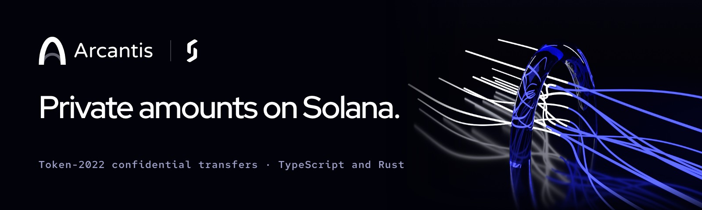

<!-- SPDX-License-Identifier: BUSL-1.1 -->
<p align="center"></p>

# Arcantis for Rust (`arcantis` crate)

[](https://crates.io/crates/arcantis)
[](https://docs.rs/arcantis)
[](https://github.com/softseco/arcantis/blob/main/rust/LICENSE)

**SPL Token-2022 confidential transfers** in Rust: encrypted balances and encrypted transfer
amounts, in a few calls. The Rust twin of the
[`@softseco/arcantis`](https://www.npmjs.com/package/@softseco/arcantis)
TypeScript SDK, with the same keys, the same checks and the same error codes.

> **Status: `1.0.0-rc.2`**, the release candidate for an independent audit, continuing
> `softseco-confidential-transfers` 3.0.0 under a new name. New in rc.2: a transfer or withdraw in
> one transaction, as in the TypeScript SDK. Arcantis is self-audited, not independently audited;
> the [threat model](https://github.com/softseco/arcantis/blob/main/docs/threat-model.md)
> and the [audit scope](https://github.com/softseco/arcantis/blob/main/docs/audit-scope.md) say
> what it protects and what was checked. Configure, deposit, apply, read, transfer and withdraw;
> mints with an auditor and mints with a transfer hook; cleanup when a transfer fails partway;
> accounts owned by a program (with a complete Anchor example). Tested end to end on a local
> validator with Token-2022 v11.1, including transfers through the
> [Sentinel](https://github.com/softseco/sentinel) transfer hook. Rust 1.89 or later.

## Install

```bash
cargo add arcantis
```

## Usage

```rust
use std::sync::Arc;
use arcantis::solana_client::{nonblocking::rpc_client::RpcClient, rpc_config::CommitmentConfig};
use arcantis::ConfidentialClient;

let rpc = Arc::new(RpcClient::new_with_commitment(rpc_url, CommitmentConfig::confirmed()));
let client = ConfidentialClient::new(rpc, Arc::new(payer)).with_compute_unit_price(10_000);

client.configure_account(&alice, &mint).await?;            // creates the account if needed
client.deposit(&alice, &mint, 1_000).await?;               // public -> confidential (pending)
client.transfer(&alice, &mint, &bob.pubkey(), 400).await?; // applies the pending 1,000 first
client.withdraw(&alice, &mint, 100).await?;                // confidential -> public
let balance = client.decrypt_balance(&alice, &mint).await?; // 500
```

The `payer` pays every fee, and the temporary rent of any proof accounts, which it gets back.
Owners sign their own operations. The client and the futures of its methods are `Send`, so calls
can be spawned on a multi-threaded runtime.

The crate pins its Solana dependencies to exact versions, and re-exports the three whose types
are in its API: `arcantis::solana_client`, `arcantis::solana_sdk` and `arcantis::solana_zk_sdk`.
Use those rather than your own dependency on the same crates: a `Pubkey` or an `RpcClient` from
another version is a different type and does not fit.

What the client takes care of:

- **What is pending.** Incoming amounts land in the pending balance. A one-transaction transfer or
  withdraw applies them first, in the same transaction, and builds its proofs from the balance
  after the apply; if another payment lands meanwhile, Token-2022 refuses the whole transaction and
  the client builds it again (`with_apply_pending(false)` spends the available balance only).
  `apply_pending_balance` on its own is checked the same way, by a withdraw of zero in its
  transaction (`with_checked_apply`), so the account's two copies of its balance cannot drift
  apart. `decrypt_balance_with_pending` reads what can be spent.
- **A known recipient key.** `transfer_to_known_key` takes the recipient's ElGamal key from your own
  records and refuses the transfer, before encrypting anything, if the RPC reports another one
  (`ErrorCode::RecipientKeyMismatch`).
- **Closing an account.** `close_account` closes an emptied account in one transaction (an apply if
  anything is pending, a zero-ciphertext proof, `EmptyAccount`, `CloseAccount`) and returns its rent
  deposit; it refuses an account that is frozen or still holds a public or confidential balance.
- **One transaction.** A transfer needs three zero-knowledge proofs, a withdraw two. Since
  September 2026 Solana takes v1 transactions of up to 4,096 bytes, and the client sends the
  proofs inside the transfer's or withdraw's own transaction: about 2,700 bytes for a transfer
  through a transfer hook. The compute budget is set from a simulation. No proof accounts, no
  rent held, nothing to clean up when the chain refuses it.
- **Proof accounts when needed.** When one transaction would be too large (a transfer hook with
  many accounts), or `with_single_transaction(false)` asks for it (an RPC that does not take v1
  transactions), the proofs are verified into temporary proof accounts first (four transactions
  for a transfer, three for a withdraw), and the transfer closes them in its own transaction.
- **Failures partway** (with proof accounts). If a step fails after proof accounts were created,
  the client closes them
  and the error says which step failed and which accounts were closed (`Error::step`,
  `Error::proof_accounts`). `recover_proof_accounts()` closes any left behind by a process that
  stopped: every proof account whose authority is the payer. A range-proof account whose
  verification never landed has no authority yet; recovery does not find it, and the error lists
  it in `ProofAccounts::unverified`.
- **Lost confirmations.** When the RPC fails after a transaction was sent, the client keeps asking
  until the transaction is confirmed or its blockhash has expired, so that a transfer that landed
  is not reported as failed. If that cannot be learned either, the error names the transaction
  (`Error::unknown_outcome`) and the proof accounts are left alone (`ProofAccounts::unknown`).
- **Checks before signing.** A missing or unconfigured account, a source or recipient not approved,
  a recipient that does not accept confidential transfers or whose pending balance is full, a
  paused mint, a mint with a transfer fee, more than the balance, more than one transfer can
  carry: each fails with its own `ErrorCode` before anything is sent.
- **The mint's auditor key** is read from the mint, and every amount is encrypted to it.
- **Transfer hooks.** The accounts a mint's hook needs are resolved and passed along, before the
  proofs are paid for. A hook that asks for the payer or the owner, or for any signer, is refused.
- **Priority fees** (`with_compute_unit_price`, micro-lamports per compute unit) on every
  transaction that has room, and resending after an expired blockhash (`with_max_retries`). In a
  v1 transaction the fee is the price times the compute-unit limit, rounded up.
- **What errors print.** Messages, `Debug` and sources leave out decrypted balances
  (`Error::available_balance` has the one a caller may need) and the RPC URL's path, query and
  user info, where providers put API keys.

### Errors

Every function returns `arcantis::Result`. `Error::code()` is an
`ErrorCode` with the same meaning as the TypeScript SDK's codes (`ErrorCode::as_str` gives the
TypeScript spelling, e.g. `"PENDING_BALANCE_LIMIT"`):

```rust
if let Err(e) = client.transfer(&alice, &mint, &bob, amount).await {
    match e.code() {
        ErrorCode::PendingBalanceLimit => { /* Bob has to apply his pending balance first */ }
        _ if e.is_retryable() => { /* the blockhash expired: run it again */ }
        _ => return Err(e.into()),
    }
}
```

### Auditor

```rust
let auditor = derive_auditor_keypair(&auditor_wallet)?;          // from the auditor's wallet
let amount = decrypt_auditor_amount(&auditor, &lo, &hi)?;        // from a transfer's ciphertexts
```

For a report of every transfer of a mint, the TypeScript package has
`listConfidentialActivity` and an `audit-report` command.

### Accounts owned by a program

A token account owned by a PDA cannot sign the key-derivation message, and a program cannot
generate proofs. So an operator derives the account's keys with
`ConfidentialKeys::derive_for_pda_wallet`, the client prepares each step, and the program makes the
Token-2022 call through CPI:

| Client | Program |
|---|---|
| `prepare_configure(&keys)` | `ConfigureAccount` with the proof account |
| `pending_balance_update(&mint, &token, &keys)` | `ApplyPendingBalance` |
| `prepare_transfer(&mint, &token, &keys, &destination, amount)`, `transfer_hook_accounts(..)` | `Transfer` with the three proof accounts |
| `prepare_withdraw(&mint, &token, &keys, amount)` | `Withdraw` with the two proof accounts |
| `close_proof_accounts(..)` afterwards | |

[`examples/anchor-vault`](https://github.com/softseco/arcantis/tree/main/rust/examples/anchor-vault) is a complete Anchor program built this way: a
vault that receives confidential transfers and pays out of its confidential balance, through a
transfer hook, with the mint's auditor reading every payout.

### Keys

Keys come from the owner's wallet with the standard derivation: one signature over
`solana-conf-bal/v1`, the same keys for every mint and account the wallet owns, recoverable and
never stored, and identical to what the TypeScript SDK, the spl-token CLI and other standard
clients derive. `ConfidentialKeys::derive(&wallet)` gives them directly. The bytes are pinned by
[shared test vectors](https://github.com/softseco/arcantis/tree/main/test-vectors) that both SDKs
check.

## Upgrading from `softseco-confidential-transfers`

Arcantis is the same crate under a new name: depend on `arcantis` and import `arcantis::` instead
of `softseco_confidential_transfers::`. Types, functions, keys and error codes are those of 3.0,
except that the 2.x free functions (`configure_account(rpc_url, payer, owner, mint, decimals)` and
so on), deprecated since 3.0.0, are gone: use `ConfidentialClient`. Accounts and keys are
unchanged.

## Build and test

```bash
cd rust
cargo fmt --all --check
cargo clippy --all-targets -- -D warnings
cargo test                     # unit tests and the shared vectors; on-chain tests skip
```

The on-chain tests need a local validator from Agave 4.x with the Token-2022 build in
[`test/fixtures`](https://github.com/softseco/arcantis/tree/main/test/fixtures) (and Sentinel, for
the transfer-hook test):

```bash
TOKEN_2022_SO=test/fixtures/spl_token_2022.so SENTINEL_SO=test/fixtures/sentinel.so \
  bash scripts/start-test-validator.sh            # from the repository root
cd rust && CT_LOCAL_PROGRAM=1 cargo test -- --test-threads 1
```

Dependencies are pinned with `=` to the set `spl-token-client` 0.19.1 resolves to; bump them
together or not at all.

## License

Business Source License 1.1, the same as the TypeScript package; see
[LICENSE](https://github.com/softseco/arcantis/blob/main/rust/LICENSE) and, in plain words,
[COMMERCIAL-LICENSE.md](https://github.com/softseco/arcantis/blob/main/COMMERCIAL-LICENSE.md). Versions published as
`softseco-confidential-transfers` (up to 3.0.0) remain available under Apache-2.0.
